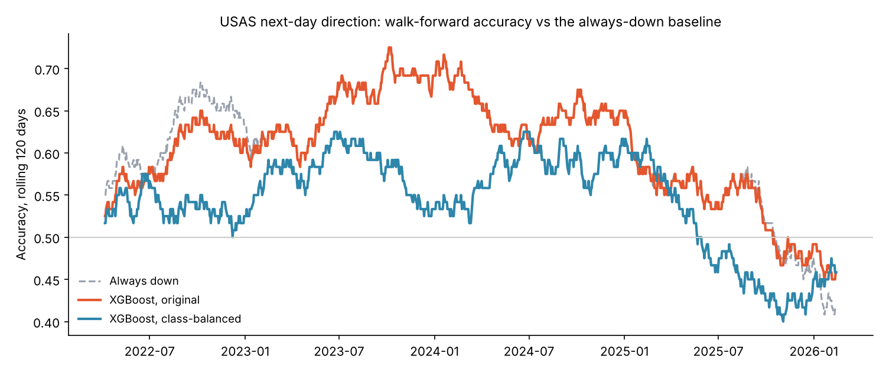

# Batman AI Trading

An end-to-end machine-learning trading system for one stock (USAS, Americas Gold and Silver): data pipeline, LSTM and XGBoost models, strict walk-forward validation, risk-managed signals, a backtester, a Streamlit dashboard and a scheduled overnight run that emails the day's signal.

**The headline result is negative, and that is the point of this README.** After fixing how the model was evaluated, it has no measurable edge in predicting next-day direction. The engineering is solid; the signal isn't there. Details below.

**Live dashboard: [batman-ai-trading.streamlit.app](https://batman-ai-trading.streamlit.app)** · pick any ticker, retrain the model walk-forward, and see whether it beats the baselines, today's gated signal and a cost-aware backtest.



## What it does

| Stage | File | What happens |
|---|---|---|
| Data | `data_pipeline.py` | Pulls daily prices for USAS plus gold (GC=F) and silver (SI=F) futures from Yahoo Finance, then builds 45 features: trend, momentum, volatility, volume, lagged returns, metal-price trends and price-derived "proxy sentiment". Target: does tomorrow close higher than today? |
| Models | `model_core.py`, `model_xgb.py` | A PyTorch model with two stacked LSTM layers and dot-product attention, plus an XGBoost classifier. |
| Validation | `model_xgb.py`, `evaluate.py` | Walk-forward: train on the last 252 trading days, retrain every 30, predict the next day only. No future data is ever used in training. |
| Signals and risk | `signals_risk.py` | BUY only when the model is confident (P ≥ 0.75), metals are trending up, volume is 1.5× normal and sentiment agrees. 1% account risk per trade, 1.5% stop-loss, 3% take-profit. |
| Backtest | `backtest_engine.py` | Equity curve with 0.1% commission and 0.05% slippage; reports return, Sharpe, max drawdown, win rate and profit factor. |
| Live run | `deploy_night_patrol.py` | Runs daily at 03:00 GMT: fetch, predict, signal, email. |
| Dashboard | `ui_gotham.py`, `app_core.py` | "Signal Lab" Streamlit app: market view, live model-vs-baseline test, today's signal with every gate shown, and a backtest with adjustable costs (`run_app.bat` on Windows). Falls back to a bundled USAS snapshot if Yahoo Finance is unreachable. |

## Honest results

`python evaluate.py` replays the walk-forward on 1,087 unseen trading days (Oct 2021 to Feb 2026). Only 40% of those days closed up, so a model that always says "down" is already right 60% of the time.

| Model | Accuracy | Balanced accuracy | F1 (up days) | ROC AUC | Predicts "up" |
|---|---|---|---|---|---|
| Always predict "down" (baseline) | 60.0% | 50.0% | 0.000 | – | 0% |
| Repeat yesterday's direction | 50.1% | 48.1% | 0.377 | – | 40% |
| XGBoost, original settings | 59.7% | 50.5% | 0.084 | 0.545 | 4% |
| XGBoost, class-balanced | 54.1% | 50.4% | 0.359 | 0.505 | 32% |

**What went wrong first time round.** The original run reported 60.3% accuracy and looked like a success. It wasn't: the model predicted "down" on 96% of days, which is the baseline with extra steps. The hyperparameter search was optimising raw accuracy, which on a 60/40 label rewards exactly that behaviour. In the chart above, the orange line sits on top of the grey baseline for long stretches for that reason.

**What I changed.**

- `evaluate.py` compares every model with simple baselines and reports balanced accuracy, F1 and ROC AUC, not just accuracy.
- XGBoost now weights the minority class (`scale_pos_weight`), and the hyperparameter search selects on balanced accuracy.
- Every training run logs the always-majority baseline next to the model's accuracy and warns when there's no edge.

**Conclusion.** With class balance fixed, balanced accuracy is 50.4% and AUC is 0.505. That's a coin flip (one-sided binomial test against the baseline: p = 1.0). These 45 daily technical features don't predict USAS's next-day direction, which is consistent with how hard short-horizon prediction is for liquid assets. Because the signal layer only trades on high-confidence predictions, the live system almost always outputs HOLD. That's the safe behaviour, not a bug.

Next steps I'd try: longer horizons (5 to 20 days), returns-based targets with transaction-cost-aware labels, and features that aren't functions of the price itself (fundamentals, metals-sector flows, news).

## Run it

```bash
pip install -r requirements.txt           # add `pip install torch` for the LSTM
cp config.example.yaml config.yaml        # optional: change ticker, risk settings
python data_pipeline.py USAS              # downloads prices and writes data.csv
python evaluate.py                        # honest walk-forward report -> results/
pytest                                    # 14 tests (LSTM tests skip without PyTorch)
streamlit run ui_gotham.py                # the dashboard
python main.py --help                     # train, predict, backtest, deploy
```

API keys and email credentials are read from environment variables, never from files in the repo:

| Variable | Used for |
|---|---|
| `ALPHA_VANTAGE_KEY`, `NEWSAPI_KEY` | Live news sentiment (optional) |
| `BATMAN_EMAIL_FROM`, `BATMAN_EMAIL_PASSWORD`, `BATMAN_EMAIL_TO` | Daily signal email (Gmail app password) |

## Disclaimer

A learning project, not financial advice. It never places trades; it only produces signals.
